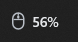

# Logitech Superlight & SteelSeries Battery Indicator

A tiny, open-source native **C++20 (Win32 API + Direct2D)** battery indicator widget for **Logitech PRO X Superlight / Superstrike** and **SteelSeries wireless** mice on Windows 10/11 — **no Logitech G HUB or SteelSeries GG required**, zero input lag for CS2 / competitive FPS, and native Windows taskbar docking.



---

## Features

- **Native Windows Binary:** Single static-linked `.exe` (`< 1.5 MB` on disk, `< 12 MB` working set RAM), linking strictly against built-in Windows system libraries (`hid.lib`, `setupapi.lib`, `d2d1.lib`, `dwrite.lib`, `shell32.lib`, `advapi32.lib`). No Electron, WebView2, Qt, or VC++ redistributable runtime dependencies.
- **Dual-Vendor Wireless & Wired Charging Support:**
  - **Logitech HID++ 2.0 (`VID = 0x046D`):** Dynamic PID-agnostic discovery across `0x1004` (`UnifiedBattery`), `0x1000` (`BatteryLevelStatus`), and `0x1001` (`BatteryVoltage`), both over LIGHTSPEED receivers and USB charging cables.
  - **SteelSeries Wireless HID (`VID = 0x1038`):** Direct vendor-collection (`UsagePage >= 0xFF00`) battery & charging queries supporting Rival 650, Rival 3, Aerox 3/5/9, Prime, and Rival Pro (plus generic fallback for unlisted SteelSeries wireless mice).
  - **Sleep-resilient:** Retains the last known percentage (dimmed) when the mouse enters deep sleep instead of dropping to `0%` or spamming HID writes, and switches smoothly when plugging/unplugging the USB charging cable.
- **Zero-Input-Lag Architecture (CS2 / Competitive Gaming Ready):**
  - **Zero global hooks:** No `SetWindowsHookEx` mouse/keyboard hooks and no DLL injection into games or `explorer.exe`.
  - **0% idle CPU:** All USB HID (Logitech HID++ 2.0 & SteelSeries) I/O runs on a `THREAD_PRIORITY_BELOW_NORMAL` background thread sleeping on a condition variable (default `60s` interval), never touching OS mouse polling collections (`UsagePage 0x01`) or interfering with `1000–8000 Hz` polling rates.
  - **Fullscreen game auto-hide:** Detects fullscreen/borderless games via `SHQueryUserNotificationState` and foreground monitor bounds, automatically hiding the docked taskbar widget when CS2 is active and restoring it cleanly on Alt-Tab.
- **Taskbar Docking & Floating Pill Modes:**
  - Docks natively onto `Shell_TrayWnd` right next to `TrayNotifyWnd`, matching Windows 11/10 taskbar height, DPI scaling, and light/dark themes, or switches to a sleek `#0E1013` / `#1E2229` floating pill (`Tryb pływający` / `Floating mode`).
  - Automatic English / Polish tray menu localization via Windows UI language (`GetUserDefaultUILanguage`), optional once-per-cycle silent low-battery tray notification (deferred during fullscreen games), and toggleable per-user Windows startup (`HKCU\Software\Microsoft\Windows\CurrentVersion\Run`, no admin privileges required).

---

## Supported Mice

| Brand | Supported Models | Connection Modes |
| :--- | :--- | :--- |
| **Logitech** | PRO X Superlight (Gen 1), PRO X Superlight 2, PRO X Superlight 2 DEX, PRO X2 Superstrike, and other HID++ 2.0 mice (dynamic PID discovery) | LIGHTSPEED 2.4 GHz & USB wired charging |
| **SteelSeries** | Rival 650 Wireless (`0x1726` / `0x172B`), Rival 3 Wireless (Gen 1 & Gen 2), Aerox 3 / Aerox 3 Gen 2 / Aerox 5 / Aerox 9 Wireless (+ special editions), Prime / Prime Mini Wireless, Rival Pro, plus generic wireless fallback | 2.4 GHz dongle & USB wired charging |

---

## Building from Source (Visual Studio / CMake)

### Prerequisites
- Windows 10/11 SDK
- Visual Studio 2022 or 2026 (MSVC C++20 toolset) and CMake 3.20+

### Option 1: CMake + Visual Studio Generator

```powershell
cmake -B build -A x64
cmake --build build --config Release
ctest --test-dir build -C Release --output-on-failure
```

### Option 2: CMake + Ninja (Developer PowerShell / `vcvars64.bat`)

```powershell
cmake -B build -G Ninja -DCMAKE_BUILD_TYPE=Release
cmake --build build
ctest --test-dir build --output-on-failure
```

Output binary: `build/SuperlightBattery.exe` (or `build/Release/SuperlightBattery.exe`).

---

## Usage & CLI Flags

- **Default run (docked on Windows taskbar):**
  ```powershell
  .\SuperlightBattery.exe
  ```
- **UI preview without hardware (`--mock`):** Cycles every 4s through `87%` (normal), `64% + green bolt` (charging), and `12%` (low-battery alert):
  ```powershell
  .\SuperlightBattery.exe --mock
  ```
- **Floating pill / 4-device preview:**
  ```powershell
  .\SuperlightBattery.exe --mock --floating
  .\SuperlightBattery.exe --mock --multi
  ```
- **Hardware diagnostic probe (`--probe`):** Scans both Logitech HID++ (`VID=0x046D`) and SteelSeries vendor HID (`VID=0x1038`) interfaces, printing protocol versions, device names, and live battery readings:
  ```powershell
  .\SuperlightBattery.exe --probe
  ```

### Configuration (`config.json`)

See [`config.example.json`](config.example.json). `config.json` is generated automatically next to `SuperlightBattery.exe`:

| Key | Default | Description |
| :--- | :--- | :--- |
| `dock_to_taskbar` | `true` | Dock beside the system tray (`false` = floating pill) |
| `taskbar_offset_x` | `0` | Horizontal DIP offset relative to the system tray |
| `poll_interval_sec` | `60` | Battery polling interval in seconds (`5`–`3600`) |
| `low_battery_threshold` | `15` | Low-battery alert threshold (`%`) |
| `window_x` / `window_y` | `-1` | Saved position in floating mode (`-1` = bottom-right) |
| `always_on_top` | `false` | Keep floating widget topmost (`HWND_TOPMOST`) |
| `multi_device_mode` | `false` | Optional 4-slot layout (headset, controller, mouse, keyboard) |
| `mock_mode` | `false` | Persistent UI preview mode without hardware |
| `low_battery_notify` | `true` | Silent tray warning once per discharge cycle below threshold (deferred in fullscreen games) |

### Verification & Windows SmartScreen

Prebuilt binaries published via GitHub Releases are compiled directly on `windows-latest` from this repository and ship with `SHA256SUMS.txt`:

```powershell
Get-FileHash .\SuperlightBattery.exe -Algorithm SHA256
```

Because open-source binaries are not EV code-signed, Windows SmartScreen may prompt on first run (*More info -> Run anyway*), or you can build locally from source in seconds.

---

## Wersja polska (Szybki start)

Lekki, natywny wskaźnik baterii na pasek zadań Windows 10/11 dla myszek **Logitech** oraz **SteelSeries** — bez konieczności instalowania **Logitech G HUB** ani **SteelSeries GG**.

- **Obsługiwane myszki (2.4 GHz + ładowanie po kablu USB):**
  - **Logitech:** PRO X Superlight (Gen 1), PRO X Superlight 2, PRO X Superlight 2 DEX, PRO X2 Superstrike oraz pozostałe myszki HID++ 2.0 (dynamiczne wykrywanie po `VID=0x046D`).
  - **SteelSeries:** Rival 650 Wireless, Rival 3 Wireless (Gen 1 i Gen 2), Aerox 3 / Aerox 3 Gen 2 / Aerox 5 / Aerox 9 Wireless, Prime / Prime Mini Wireless, Rival Pro oraz ogólny tryb dla niewymienionych modeli bezprzewodowych SteelSeries.
- **Zero input laga w CS2:** brak globalnych hooków (`SetWindowsHookEx`), brak wstrzykiwania DLL, `0%` zużycia CPU w spoczynku oraz automatyczne ukrywanie widżetu na pasku zadań podczas gier pełnoekranowych.
- **Dodatkowe funkcje:** automatyczny język menu PL/EN, ciche powiadomienie z zasobnika przy niskiej baterii (`low_battery_notify`, wstrzymywane w trakcie gry) oraz diagnostyka sprzętu komendą `.\SuperlightBattery.exe --probe`.
- **Menu zasobnika systemowego (PPM na ikonę lub widżet):**
  - **Zadokuj na pasku zadań** — domyślnie osadza wskaźnik obok zegara/zasobnika (`TrayNotifyWnd`)
  - **Tryb pływający** — przełącza na kompaktową ciemną pigułkę na pulpicie
  - **Dopasuj pozycję X (przesuń)** / **Resetuj pozycję na pasku** — pozwala przesunąć widżet w poziomie na pasku zadań
  - **Odśwież teraz** — natychmiastowy odczyt baterii
  - **Uruchamiaj z Windows** — bezpieczny wpis w `HKEY_CURRENT_USER\Software\Microsoft\Windows\CurrentVersion\Run` (bez uprawnień administratora)
  - **Zamknij** — bezpieczne zamknięcie aplikacji

---

## License

Released under the [MIT License](LICENSE).
